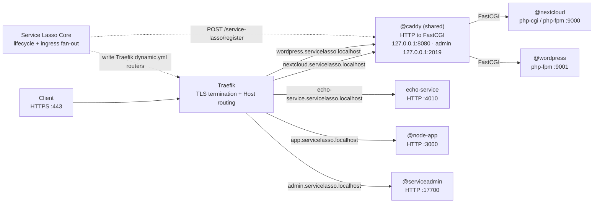

# lasso-caddy

`lasso-caddy` is the canonical Service Lasso service repo for the core `@caddy` service. It compiles a custom Caddy build (Caddy + the Service Lasso admin API plugin) and publishes it as a release-backed Service Lasso service.

Caddy runs in the foreground as a generic **HTTP front / protocol translator** with a **Service Lasso admin API**. It accepts plain HTTP and forwards each domain to the right upstream, using either the **FastCGI** protocol or a standard **HTTP reverse proxy**:

```text
Client / router  --HTTP-->  Caddy  --FastCGI-->  PHP app (php-fpm / php-cgi)
                                   \--HTTP----->  HTTP app (Node, Python, Go, Java, .NET, ...)
                        ^
         Service Lasso --|  POST /service-lasso/register  (127.0.0.1:2019)
```

Routes are not hard-coded: Service Lasso registers and unregisters upstreams at runtime, so the same `@caddy` instance can front any local app that is installed or started.

## Architecture

One shared `@caddy` instance serves every service that declares ingress. Traefik owns the public edge (domains + HTTPS termination); Caddy is the internal, loopback-only HTTP-to-FastCGI translator.



```text
                          +-----------------------------------------------+
 Client --HTTPS 443------>| Traefik   (TLS termination + Host(domain))    |
                          +-------+---------------+---------------+-------+
                                  |               |               |
        Host(nextcloud...)        |   Host(echo...)               |  Host(app...)
                                  v               v               v
                    +-----------------------+   +----------+   +----------+
                    | @caddy (shared)       |   | echo-svc |   | node-app |
                    | 127.0.0.1:8080        |   | :4010    |   | :3000    |
                    | admin :2019           |   +----------+   +----------+
                    +------+--------+-------+
                           |        |
              FastCGI :9000|        |FastCGI :9001
                           v        v
                    +----------+ +-----------+
                    |nextcloud | |wordpress  |
                    +----------+ +-----------+

 Service Lasso Core
   |- POST /service-lasso/register  -> @caddy admin (FastCGI routes)
   +- write dynamic.yml routers     -> Traefik (Host(domain) + TLS)
```

Two paths:

- **FastCGI services** (`nextcloud`, `wordpress`): Traefik terminates TLS and forwards `Host(domain)` to the shared `@caddy`, which translates to the FastCGI upstream.
- **HTTP services** (`echo-service`, node app, serviceadmin): Traefik routes `Host(domain)` straight to the service endpoint; Caddy is not involved.

## Ingress contract

A service opts in by declaring one or more ingress entries. `domain` is consumed by Traefik (Host + TLS) and by Caddy for host matching; `proxy` is consumed by Caddy. Every registration uses the shared Caddy web port, never a per-service port.

```json
"ingress": [
  {
    "domain": "nextcloud.servicelasso.localhost",
    "proxy": {
      "type": "fastcgi",
      "endpoint": "fastcgi",
      "root": "${NEXTCLOUD_SOURCE_DIR}"
    }
  }
]
```

```json
"ingress": [
  {
    "domain": "echo-service.servicelasso.localhost",
    "proxy": { "type": "http", "endpoint": "service" }
  }
]
```

## What it can front

Two upstream types are supported by the admin API.

### `type: "fastcgi"`

For applications served by a FastCGI process manager. The common case is PHP:

- **PHP-CGI / PHP-FPM** applications: Nextcloud, ownCloud, WordPress, Drupal, Joomla, Laravel, Symfony, Magento / Adobe Commerce, MediaWiki, Moodle, phpMyAdmin, Matomo, Kimai, and similar.
- Any other backend that speaks FastCGI. Script splitting currently uses `.php`, so non-PHP FastCGI runtimes may need a different split path.

### `type: "http"`

For anything that already speaks HTTP (including WebSockets, which `reverse_proxy` upgrades automatically):

- Node.js (Express, Fastify, NestJS, Next)
- Python (uvicorn / gunicorn / ASGI / WSGI served over HTTP)
- Go (`net/http`, chi, Gin, Echo)
- Java (Spring Boot, servlet containers)
- .NET / ASP.NET Core (Kestrel)
- Ruby (Puma, Unicorn), Rust (axum, actix-web)
- Static file servers and internal admin/metrics endpoints

The translator is what lets Service Lasso expose a FastCGI-only backend (such as a PHP app) through a normal HTTP router without teaching the router the FastCGI protocol.

## Custom build

The binary is not stock Caddy. `scripts/build-caddy.mjs` uses [`xcaddy`](https://github.com/caddyserver/xcaddy) to compile Caddy with the in-repo plugin:

```text
github.com/caddyserver/caddy/v2   +   github.com/service-lasso/lasso-caddy/plugin
```

A Go toolchain is required. If `xcaddy` is not on `PATH` it is installed into `output/tools` automatically.

## Service Lasso admin API

The plugin registers the `admin.api.lasso` module and mounts two endpoints on the Caddy admin listener (loopback only):

### `POST /service-lasso/register`

FastCGI upstream:

```json
{
  "id": "@wordpress",
  "domain": "wordpress.servicelasso.localhost",
  "ingress_port": 50123,
  "type": "fastcgi",
  "target": "127.0.0.1:61124",
  "root": "/absolute/path/to/wordpress"
}
```

HTTP upstream:

```json
{
  "id": "@node-app",
  "domain": "app.servicelasso.localhost",
  "ingress_port": 50124,
  "type": "http",
  "target": "127.0.0.1:3000"
}
```

`type` is `fastcgi` (requires `root`) or `http`. Registration:

- points the managed server (`lasso_ingress`) listener at the dynamically allocated `ingress_port` (bound to `127.0.0.1` so the OS does not prompt for a host firewall exception);
- injects or replaces the route keyed by `@id` = `lasso:<id>`, matched on `domain`, with the upstream set to `target`;
- disables automatic HTTPS on the server so no certificates are provisioned;
- hot-reloads the running config via `caddy.Load`, so there is zero downtime.

Re-registering an existing `id` updates that route in place without duplicating the route array.

### `POST /service-lasso/unregister`

```json
{ "id": "@wordpress" }
```

Removes the route for `id`. Removing an unknown id is a no-op.

Both endpoints return `{"status":"success"}` on success. Validation failures return `400`, mutation failures `422`, and a rejected `caddy.Load` returns `500` while leaving the previous routing state untouched (fail-closed).

## Service Lasso contract

The service manifest declares:

- service id `@caddy`
- a `web` HTTP endpoint (loopback, preferred port `8080`) that the router routes into
- an `admin` HTTP endpoint (loopback, preferred port `2019`) for the admin API
- a manifest-owned `runtime/caddy.json` base config generated during the `config` action
- a `/health` readiness responder
- `CADDY_HTTP_PORT`, `CADDY_URL`, `CADDY_ADMIN_PORT`, `CADDY_ADMIN_ADDR`, and `CADDY_ROOT` outputs

`@caddy` declares no service dependencies: it is a generic front that is configured entirely through the admin API.

## Release assets

Each release publishes Caddy `2.11.7` archives built from this repo:

- `lasso-caddy-2.11.7-win32.zip`
- `lasso-caddy-2.11.7-linux.tar.gz`
- `lasso-caddy-2.11.7-darwin.tar.gz`
- `service.json`
- `SHA256SUMS.txt`

Each archive contains the custom Caddy binary plus a `SERVICE-LASSO-PACKAGE.json` metadata file recording the Caddy version and the compiled plugin.

## Local verification

```powershell
npm test
```

This builds the custom binary, packages and extracts it, runs `caddy version`, starts Caddy against a temporary base config, then exercises the admin API end-to-end: registers an HTTP upstream, confirms the domain routes to it, checks `/health`, unregisters, and confirms the route is gone.

## Packaging

```powershell
npm run package
```

Override the target platform or upstream Caddy version when needed:

```powershell
$env:TARGET_PLATFORM = "linux"; $env:CADDY_VERSION = "2.11.7"; npm run package
```
